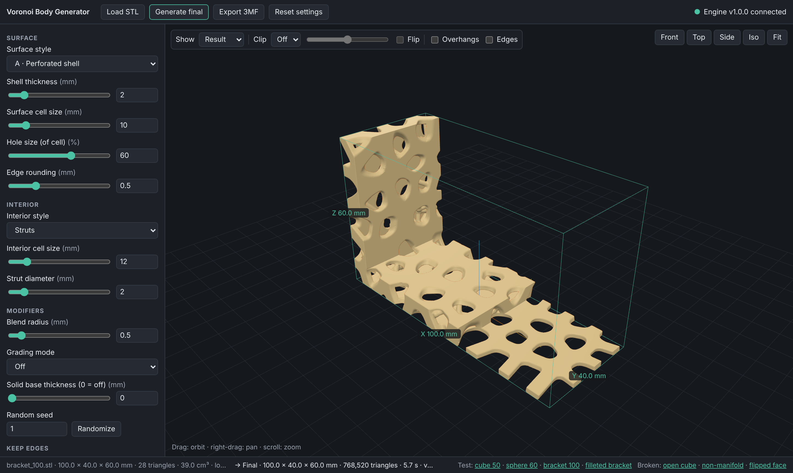
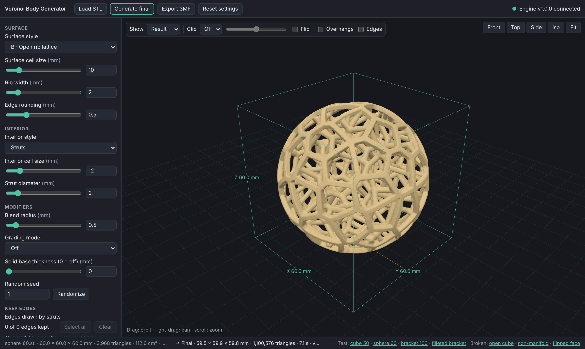
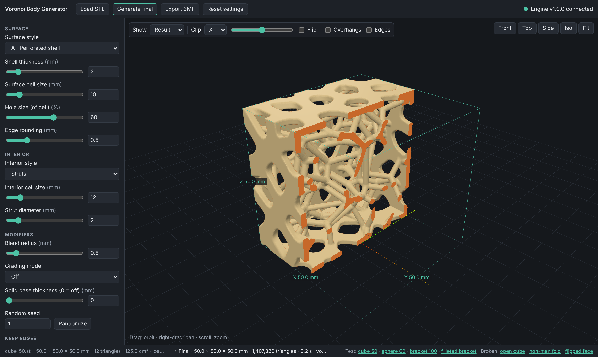
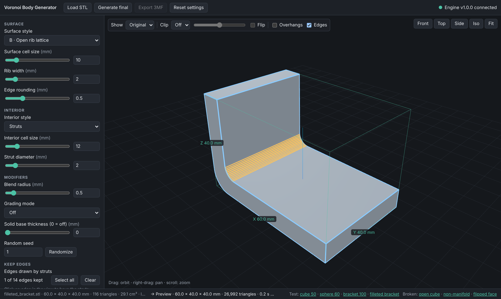

# Voronoi Body Generator

Turns an STL into a printable Voronoi body with the same outer envelope: a patterned skin
(holes, ribs or embossed cells) joined to a 3D Voronoi strut lattice inside. Runs locally;
the UI opens in your browser. Made for FDM printing: every export is checked to be watertight,
manifold and one connected body.



| | |
|---|---|
|  |  |
| Open rib lattice (style B) with struts inside | Clipping plane: the struts join the 2 mm shell |
|  |  |
| Model edges in blue; a picked fillet in orange | Kept edges are drawn by the lattice's ribs |

## What it does

- **Surface styles:** A · perforated shell with rounded Voronoi holes, B · open rib lattice,
  C · embossed ribs on a closed shell, None, or a plain solid shell.
- **Interior styles:** 3D Voronoi struts with filleted joints, solid, or hollow; every surface
  style combines with every interior style.
- **Modifiers:** grading of cell size and/or thickness (from the skin, or along X / Y / Z), blend
  radius, solid base, random seed (same settings and seed give a byte-identical file).
- **Keep edges:** pick edges of the model (sharp edges and fillets) to be drawn by struts.
- **Output:** smoothing onto the exact shape, edge rounding, printability warnings, overhang view,
  automatic repair of its own defects, 3MF or binary STL export with a settings file next to it.

How it works: every shape is a signed distance field evaluated on a voxel grid and turned into a
mesh with marching cubes, so the output is watertight by construction (details in
[DECISIONS.md](DECISIONS.md)). The requirements are in [SPEC.md](SPEC.md).

**Status:** version 1.0. All eight steps of the build plan are done, plus later additions (edge
rounding, smoothing, edges drawn by struts, multi-core generation, 3MF export). See "Acceptance
criteria" below for what is tested automatically and what is left to check by hand.

## Requirements

- Python 3.10 – 3.14 (3.13 recommended). Python 3.15 is too new: the geometry libraries have no
  packages for it yet. If it is your only Python, add 3.13 with `py install 3.13` on Windows;
  the start script then picks it automatically.
- Node.js 20 or newer - optional. The repository contains the UI pre-built in `frontend/dist`;
  Node.js is only needed to rebuild the UI after changing its source.

## Start

```bash
git clone https://github.com/marsovc/voronoi-converter.git
```

```bash
cd voronoi-converter
```

```bash
./start.sh
```

On Windows: `start.bat`.

The first run creates `.venv` and installs the Python packages (a few minutes); with Node.js
installed it also rebuilds the UI. Then the app opens at http://127.0.0.1:8000. Stop it with Ctrl+C.

Options: `--port 8080`, `--no-browser`, `--test` (run the test suite instead of starting).

## Use

- **Load STL** (or drop a file on the window): binary or ASCII STL, units are millimetres.
  A broken mesh (open edges, non-manifold edges, flipped faces, inside-out, flat) is refused
  with a list of what is wrong; it is not repaired.
- **View:** drag to orbit, right-drag to pan, scroll to zoom; Front / Top / Side / Iso / Fit buttons.
- **Clip:** pick X, Y or Z and move the slider to cut the part open; Flip shows the other half.
- The links at the bottom right load built-in test models, including a filleted bracket and three broken ones.
- **Preview:** after loading, and 0.3 s after any setting changes, a coarse preview is generated.
- **Generate final** builds the fine version in the background, with a progress bar and Cancel.
  Changing a setting while it runs cancels it and starts a new preview.
- **Final quality** (Draft / Normal / Fine) puts 3 / 4 / 6 voxels across the thinnest feature.
  The grid is also limited by a memory budget (40 % of the installed RAM, at most 8 GB); a
  warning tells you when a limit made the result coarser. To change the budget, set the
  environment variable `VORONOI_MEMORY_MB` before starting.
  Generation uses all CPU cores; to limit it, set `VORONOI_THREADS` (for example 2).
- **Export** is enabled once Generate final has produced a result that passed validation
  (watertight, consistent winding, positive volume, one body). It downloads the model as
  `<input name>_voronoi.3mf` (or `.stl`, see Export format) and, next to it,
  `<input name>_voronoi.json` with the settings used. Changing a setting that changes the shape
  disables Export until you generate final again; changing only the export format does not.
- **Export format** (Print group): 3MF (default) or binary STL. 3MF holds exactly the same
  triangles but is about 4–6 times smaller (each point stored once, compressed) and states the
  unit (millimetres). PrusaSlicer, Cura, Bambu Studio and OrcaSlicer open both.
- **Reproduce a result:** load the same STL, then load (or drop) the saved `.json`; Generate final
  then gives a byte-identical file.
- **Edge rounding** (styles A, B, C, default 0.5 mm): rounds the edges of the skin pattern (rib
  edges, hole rims, recess edges) with this radius. Combined with Smoothness it removes the
  saw-tooth look of the skin. The edges of your original part stay sharp, so its dimensions do
  not change. Set 0 for edges as sharp as the voxel grid allows.
- **Keep edges (drawn by struts):** after loading, the edges of the model are drawn in blue:
  sharp edges (faces meeting at more than 30°) as single lines, and curved edges (fillets, rounds
  and small holes up to 8 mm radius) as bands of lines along them. Click an edge to keep it (it
  turns orange), click again to release it; Select all / Clear are in the Keep group. A kept edge
  is drawn by the lattice: a rib (style B), a strut (style None) or a hole-free strip of shell
  (style A) runs along it, Edge strut width wide (default 2 mm), and the cells end on it.
  Nothing deeper inside the part is filled. With styles C and Solid the edge is already part of
  the closed shell. Kept edges are saved in the settings file; they belong to one model, so
  loading another model clears them.
- **Smoothness** (final only): Off, Smooth or Extra smooth. Each level splits every triangle
  into four and moves the points onto the exact shape, so struts become round and edges cleaner
  without a finer voxel grid. It multiplies the triangle count (and the STL size) by 4 or 16 and
  makes the final slower; the result is limited to 12 million triangles.
- **Overhangs** colours faces that overhang more than 45° (build direction Z up).
- **Show:** Result, Original, or Overlay (original as a transparent ghost over the result).

## Acceptance criteria

| Criterion (SPEC.md) | Status | Where |
|---|---|---|
| 500,000-triangle STL loads and displays in under 5 s | automated (engine side) | `test_acceptance.py` AC1 |
| Broken STL refused with the problem named | automated | AC2 |
| Every surface × interior combination generates on the test models | automated, at final quality | AC3 |
| Bounding box within one voxel (≤ 0.3 mm), nothing outside the envelope | automated, with the exceptions below | AC4 |
| trimesh checks on the exported bytes | automated | AC5 |
| 100 mm part: final ≤ 60 s, preview ≤ 5 s at default settings | automated | AC6 |
| Same settings and seed give a byte-identical STL | automated | AC7 |
| Exported STL slices without errors in PrusaSlicer or Cura | **manual** - no slicer in the test environment | - |
| Test models generated in code | automated | AC9 |

Exceptions to the bounding-box criterion, all inherent to the shape asked for:

- **Surface None + Struts:** the lattice is cut by the envelope; it need not touch every extreme
  point, and thin features (the bracket's 2 mm flange) are lost.
- **Patterned skins (A, B, C) on curved surfaces:** if a hole or recess sits exactly at an extreme
  point, the box is short by the sagitta of that cell (0.3-0.4 mm on the 60 mm sphere).
- **Envelope:** vertices are within 1 µm of the envelope; the flat triangles between them can
  stand out by up to a tenth of a voxel at concave edges.

## Tests

```bash
./start.sh --test
```

## Layout

```
backend/
  voronoi_engine/     geometry engine (no web code)
    settings.py       the settings schema - single source of truth
    export_schema.py  generates frontend/src/generated/settings.ts
    mesh_io.py        STL loading and validation
    surface.py        exact signed distance to the input mesh
    grid.py           voxel grid and voxel-size choice
    body_field.py     distance field of the body on the grid
    lattice.py        Poisson-disk seeds and 3D Voronoi edges
    strut_field.py    distance field of round beams with blended joints
    surface_pattern.py  surface seeds and the Voronoi (Worley) pattern of the skin
    skin_attach.py    aims struts at the walls of an open skin
    grading.py        cell-size and thickness grading
    printability.py   printability warnings
    exact_field.py    the generated shape evaluated at any point
    smoothing.py      smoothness: subdivide and move onto the exact shape
    edges.py          sharp and curved (filleted) edges of the model, for picking
    edge_members.py   ribs / struts along the kept edges
    repair.py         validation and automatic repair of the result
    export.py         3MF and binary STL writers, settings document
    memory.py         memory budget
    parallel.py       runs the heavy steps on all CPU cores
    progress.py       progress and cancel hook
    meshing.py        marching cubes, fragment removal, envelope fit
    generate.py       the pipeline (preview and final)
    test_models.py    cube, sphere, bracket, filleted bracket (and broken variants) generated in code
  voronoi_server/     FastAPI app (API + serves the built UI), background jobs
  tests/              pytest suite
frontend/             TypeScript + three.js UI (Vite); dist/ is the built UI
docs/screenshots/     images used in this README
scripts/start.py      launcher used by start.sh / start.bat
```

## UI development

Run the server with `./start.sh --no-browser`, then in `frontend/` run `npm run dev`
and open http://localhost:5173 (hot reload; `/api` is proxied to port 8000).

After changing `settings.py`, regenerate the TypeScript mirror (the start script also does this):

```bash
cd backend && ../.venv/bin/python -m voronoi_engine.export_schema
```
